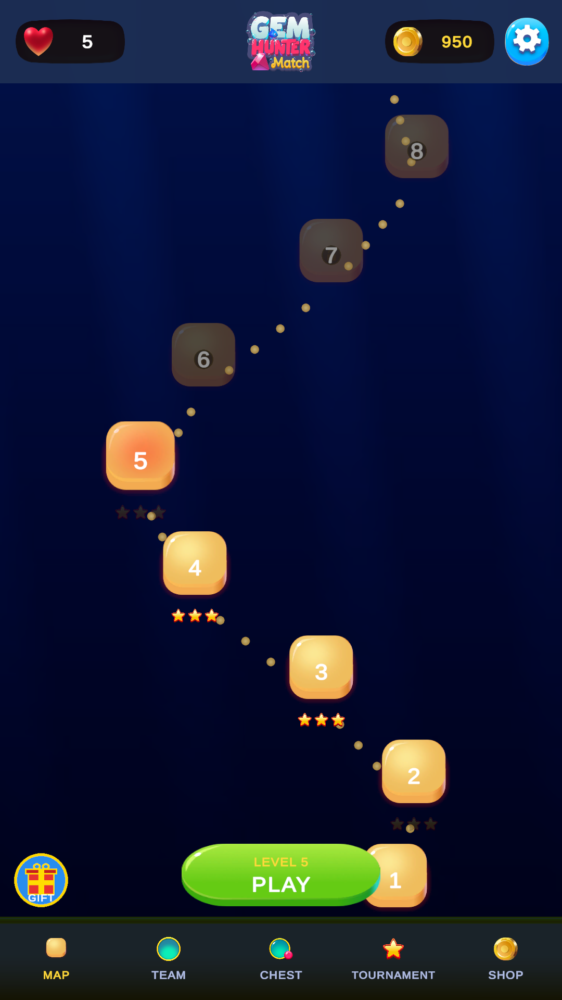
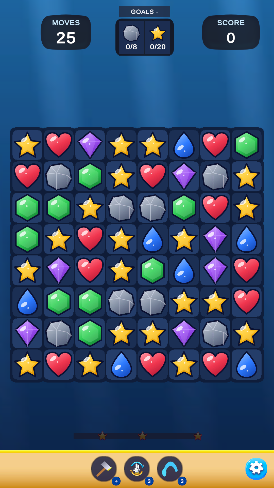

# Match-3 Game

**English** | [Türkçe](README.tr.md)

<p align="center">
  
  
</p>

<p align="center">Full gameplay video (50 MB, about 3 minutes): <a href="Screenshots/gameplay.mp4">Screenshots/gameplay.mp4</a></p>

A portrait-mode, 2D Match-3 mobile game for Android, built with Unity 6. The
project is also a study in clean, allocation-free game architecture: a single
composition root, explicit state machine, signal-based communication between
systems, and a hand-written tween system instead of a third-party tween
library on the hot path.

- Engine: Unity 6 (`6000.6.0f1` at the time of writing, targets the Unity 6 line)
- Render pipeline: Universal Render Pipeline (2D, unlit)
- Input: Unity Input System (new)
- Target platform: Android (min SDK 26). Editor and WebGL are also included in the assemblies.
- Orientation: portrait, locked
- Frame rate: 60 FPS target

---

## Table of contents

1. [Features](#features)
2. [Getting started](#getting-started)
3. [Gameplay overview](#gameplay-overview)
4. [Architecture](#architecture)
5. [Project structure](#project-structure)
6. [Systems in detail](#systems-in-detail)
7. [Performance rules](#performance-rules)
8. [Content authoring](#content-authoring)
9. [Persistence and meta systems](#persistence-and-meta-systems)
10. [Error reporting and privacy](#error-reporting-and-privacy)
11. [Testing](#testing)
12. [Roadmap](#roadmap)
13. [Coding conventions](#coding-conventions)
14. [License and credits](#license-and-credits)

---

## Features

### Core gameplay
- Swap-based Match-3 with cascades, refills and automatic reshuffle when no
  moves remain.
- Irregular board shapes: cells can be marked non-playable.
- Configurable board size and active gem color count per level.
- Diagonal gravity: gems can slide around obstacles in a deterministic way.
- Input buffering: a swipe made just before the board settles is remembered and
  applied the moment the board is idle.
- Hint system that highlights a possible move after a configurable idle delay.

### Special tiles
| Match | Result |
|---|---|
| 4 in a row | Rocket (horizontal or vertical) |
| L or T shape | Bomb |
| 5 in a line | Color Bomb |
| 2x2 square | Propeller (flies to a target) |

Two adjacent special tiles can be combined into a combo effect (for example
Rocket + Bomb, Color Bomb + Rocket). A Color Bomb combined with a special tile
converts the most common color on the board into that special tile.

### Obstacles
- Box, Rock and Ice with multi-stage damage sprites and a shake animation on hit.
- Obstacles are damaged by matches in adjacent cells, never fall, never match
  and cannot be swapped.
- Placement by manual coordinate list, random placement (Fisher-Yates), or a CSV file.

### Goals and levels
- Goal types: collect or clear tiles, create special tiles, bring ingredients
  down to the bottom row.
- Move-limited or time-limited levels.
- Score and star rating.
- Win finale: leftover moves turn into special tiles and detonate.
- "Continue with +5 moves" flow when the player runs out of moves.
- Low-moves warning (red vignette pulse for the last 5 moves).

### In-game boosters
- Hammer (breaks one cell), Glove (swaps two tiles) and Reshuffle, used from the
  bottom bar without spending a move.
- Pre-game boosters that are consumed only when a level starts fresh.

### Meta game
- Royal-Match-style main menu and a curved saga map with level preview and start flow.
- Lives with timer-based regeneration, coins, settings (sound, music, haptics).
- Save and resume: board, moves or time, score and goals survive app restarts.

### Juice
- Physics-like easing: accelerating fall, bounce on landing, soft-braked swap.
- Particle effects on match, electric beams, rocket trails, wave-delayed explosions.
- Procedural sound effects with a rising pitch on cascades, and mobile haptics.

---

## Getting started

### Requirements
- Unity 6 (the project was last opened with `6000.6.0f1`; see
  `ProjectSettings/ProjectVersion.txt`).
- Android Build Support module (for device builds).
- A Firebase project, only if you want crash reporting (see below). The game
  runs without it.

### Open the project
1. Clone the repository.
2. Open the folder with Unity Hub using the Unity version above. Unity restores
   packages from `Packages/manifest.json` on first open.
3. Open `Assets/Scenes/SampleScene.unity` and press Play.

Enter Play Mode Options with domain reload disabled are used, which is why each
signal class resets its subscribers on `SubsystemRegistration`.

### Optional packages
`Packages/manifest.json` contains some editor-only packages (for example the
Unity AI assistant). They are not needed to run or build the game and can be
removed from the manifest.

### Firebase (optional, Android only)
The repository does not contain Firebase configuration. Crashlytics is wired
through the `ErrorHandling` module and is compiled only for Android device builds
(`UNITY_ANDROID && !UNITY_EDITOR`).

To enable it:
1. Create a Firebase project and add an Android app with your own package name
   (set it in Player Settings, it is currently `com.karayilann.match3game`).
2. Download `google-services.json` and place it at `Assets/DataTracking/google-services.json`.
3. Let the Firebase Unity importer generate its Android resources.
4. Restrict your API key in Google Cloud Console to your package name and SHA-1
   signing certificate.

These paths are git-ignored on purpose, so your config is never committed. In
the editor the project uses `NullErrorReporter` and needs none of this.

### Building
Use `File > Build Settings > Android`. For a release build, create your own
keystore. Never commit keystores or their passwords.

---

## Gameplay overview

The player swaps two adjacent gems. If the swap creates a match of three or
more, the matched gems are cleared, gems above fall down, new gems fill from the
top, and the cycle repeats while new matches appear. If a swap creates no match
it is animated back. Levels end in a win when all goals are met, or in a loss
when moves or time run out (with an option to continue).

Flow of one turn:

```
Idle -> Swap -> (Match -> Fall -> Fill -> Match ...) -> Idle | Reshuffle
```

---

## Architecture

### Principles
- Clean Architecture with one-way assembly dependencies and no cycles.
- A single composition root (`BoardController`) wires everything with manual
  constructor injection. There is no DI container.
- Systems talk to each other through four static signal classes. Steps inside
  the board loop call each other directly through the state machine.
- Zero allocation on hot paths, byte-level data layout where it pays off.
- YAGNI and KISS: abstractions are added when needed, not in advance.

### Assemblies

| Assembly | References |
|---|---|
| `Core`, `Utils`, `Ads`, `ErrorHandling` | none |
| `Signals` | `Core` |
| `View` | `Core`, `Signals`, TextMeshPro, PrimeTween |
| `Gameplay` | `Core`, `Signals`, `View`, `Utils`, `ErrorHandling`, Input System, uGUI |

All assembly definitions include only the Editor, Android and WebGL platforms
("Any Platform" is off, and "Include" mode is used).

### Signals
Cross-system communication goes through four classes in the `Signals` assembly:
`BoardSignals`, `LevelSignals`, `EconomySignals` and `UiSignals`.
- Every signal is a `public static event`; raising happens through `RaiseX(...)`,
  so outside code cannot assign or invoke the event directly.
- Each class clears its subscribers in `Reset()` on `SubsystemRegistration`,
  which keeps the project safe with domain reload disabled.
- When adding a signal, add the event, its `Raise` method and its `Reset` line together.

### State machine
`GameStateMachine` and the states live under `Gameplay/States`:

| State | Responsibility |
|---|---|
| `IdleState` | Enables input, runs the hint timer. |
| `SwapState` | Disables input, animates the swap, validates it, reverses it if no match. Rejects swaps that touch locked cells. |
| `MatchState` | Finds matches, damages adjacent obstacles, spawns special tiles, plays the clear batch, then decides between Idle and Reshuffle. |
| `FallState` | Column-based multi-pass gravity with diagonal slides. Locked cells stop the write pointer. |
| `FillState` | Drops new gems from one row above the grid, with fall distance based on the gap size. |
| `ReshuffleState` | Fisher-Yates shuffle of unlocked cells, up to 20 attempts until there is no match and at least one move. |

States do not call `ChangeState` directly when work finishes. They start a
`BoardAnimator` batch with a completion callback, so a cascade chain never nests
inside one frame and every step stays visible. States depend on small bundles
(`BoardData`, `BoardPresentation`, `LevelServices`) so each one receives only
what it needs. States are created first and linked once through `BoardStates.Init(...)`
because they reference each other.

### Animation
- `BoardAnimator` is a thin MonoBehaviour with a single `Update` that drives all
  animations. Individual tiles have no `Update`.
- `TweenRunner` holds a pre-sized command list with easing and O(1)
  swap-with-last removal.
- `ElectricBeamRenderer` and `RocketTrailRenderer` pool `LineRenderer`s.
- `SpecialTileChoreographer` sequences special-tile effects (wave delays,
  projectiles, beams, particles) into the same batch.
- UI animations use PrimeTween in the `View` assembly. Board animation uses the
  hand-written tween system.

### Rendering and input
- The board is World Space `SpriteRenderer`s. No Canvas is used for the grid, to
  avoid UI rebuild cost. Canvas is used for the HUD only.
- No colliders and no Physics2D. A touch is converted to a grid coordinate with
  math (`GridToWorldConverter`, using a cached inverse cell size).
- `BoardInputHandler` uses the new Input System with event-driven actions (no
  `Update`), separates tap from swipe by a pixel threshold, and guards against
  byte underflow.
- `CameraFitter` fits the orthographic size to the board and the HUD areas.

---

## Project structure

```
Assets/
  Scripts/
    Core/             data types, state machine base, pooling, singleton
      Data/           Tiles, Level, Goals, Obstacles
      StateMachine/   IGameState, GameStateMachine
      Pooling/        IPoolableObject, PoolManager<T>
      Singleton/      MonoSingleton<T>
    Gameplay/
      Board/          BoardModel, BoardController (composition root), converters, camera fit
      Matching/       MatchDetector, PossibleMoveDetector
      States/         Idle, Swap, Match, Fall, Fill, Reshuffle
      Input/          BoardInputHandler
      Spawning/       TileSpawner
      Animation/      BoardAnimator, TweenRunner, beams, trails, choreography
      Obstacles/      ObstacleService, ObstaclePlacer
      Boosters/       in-game and pre-game boosters
      Hints/          HintService
      Ingredients/    ingredient goal logic
      Scoring/        ScoreService
      Goals/          GoalLoader, GoalService
      Flow/           AppBootstrap, MenuFlowController, WinFinaleController
      Persistence/    key-value store, save and load
      Economy/        PlayerInventory, EconomyRequestHandler
      Lives/          LivesService, LivesController
      Progress/       ProgressService
      Settings/       SettingsService
      Clock/          ITimeProvider, SystemTimeProvider
      Audio/          procedural sound and haptics
    Signals/          BoardSignals, LevelSignals, EconomySignals, UiSignals
    View/             GemView, particles, HUD, view-side animation
    ErrorHandling/    IErrorReporter, ErrorReporter, Firebase provider
    Ads/              reserved for the ad abstraction
    Utils/            Debug wrapper, CsvSpanReader
  Tests/
    EditMode/         logic and service tests
    PlayMode/         board flow, save/resume, fuzz tests
  ScriptableObjects/  levels, obstacle and tile databases
  Scenes/             SampleScene
  Audio, Sprites, Prefabs, Materials, Resources, StreamingAssets
```

Folders are split by domain ("what is this type"), not by who uses it. An
`Utils` folder holds only pure, stateless helpers. Interfaces live next to their
implementation in the feature folder, not in a central folder.

---

## Systems in detail

### Data layer (`Core/Data`)
- `GridCoord`: `readonly struct`, two `byte`s.
- `TileType` (byte enum): `None, Red, Blue, Green, Yellow, Purple, White, Box`.
  `Box` marks a cell that carries an obstacle, it is not a color.
- `CellFlags` (byte flags): `None, NonPlayable, Locked, ...`.
- `GridCell`: type, flags and durability, packed with `Pack = 1`.
- `TileTypeLibrary.PLAYABLE_TYPES` is the single source for the spawn pool. To
  add a color: extend the enum, add it to that array, and add a sprite to
  `TileSpriteDatabase` at the matching index. No other code changes.
- `TileSpriteDatabase` sprites must be filled in enum order.

### Matching
- `MatchDetector`: row and column run-length scan. No flood fill, no recursion.
  Minimum run is 3. Non-playable, locked and empty cells are ignored. The match
  flag array is allocated once.
- `PossibleMoveDetector`: tries a hypothetical swap with the right and bottom
  neighbor of each cell, checks it with `MatchDetector`, reverts, and stops at
  the first hit. It runs once when the board settles. It can also return the
  coordinates for the hint system.
- `TileSpawner` fills the initial board without any pre-made matches, which is
  important because `MatchDetector` scans the whole board and would otherwise
  accept any swap as valid.

### Obstacles
An obstacle cell has `CellFlags.Locked` set. `ObstaclePlacer` sets it and
`ObstacleService` clears it when durability reaches zero. An obstacle takes at
most one hit per resolve pass. `ObstacleDefinition` carries behavior fields
(`CanTakeAdjacentDamage`, `SpawnsTileOnDestroy`, `CanFall`) so new obstacle
types can be data driven.

### Goals and scoring
`GoalLoader` builds goals from the level data (Inspector array or CSV).
`GoalService` tracks progress and raises signals. `ScoreService` scores matches
using `PointsPerTile` from the level.

### Object pooling
`Core/Pooling` is a standalone module: `IPoolableObject` (`OnSpawn`,
`OnDespawn`) and `PoolManager<T>` (queue based, prewarm support). It can be
copied into another project as is.

### HUD
The HUD uses a `Scale With Screen Size` canvas (reference 1080x1920, match 0.5),
applies `Screen.safeArea` through `SafeAreaFitter`, and uses TextMeshPro. Popups
share a common `PopupView` base under a `PopupCanvas`.

---

## Performance rules

- No allocations on hot paths: no `new List<>()`, no LINQ, no `foreach` over
  `List`, no string building. Buffers are allocated once in constructors and
  reused with `Clear()`.
- A constant divisor is turned into a cached reciprocal and used as a multiply.
- Lifetime constants (width, height) are `readonly` fields, not method parameters.
- Small structs use `[StructLayout(LayoutKind.Sequential, Pack = 1)]`; frequently
  called property getters use `[MethodImpl(MethodImplOptions.AggressiveInlining)]`.
- `byte` is used for coordinates, types and flags. World positions stay `float`.
- One `BoardAnimator.Update` for all animation, no per-tile `Update`.
- `Transform` references are cached in `GemView` to avoid native-managed crossings.
- Two sprite atlases (`Assets/Sprites/Atlases`), mipmaps off, MSAA off, no
  post-processing, no real-time lights or shadows.

### Verifying the claims

`Assets/Tests/EditMode/HotPathPerformanceTests.cs` turns the rules above into
tests that fail when they are broken:

- `MatchDetector` and `PossibleMoveDetector` must allocate exactly 0 bytes over
  2000 scans of an 8x8 board after warmup (measured with
  `GC.GetAllocatedBytesForCurrentThread`).
- Both must stay inside a loose time budget per scan, which catches accidental
  O(n^2) regressions. The measured microseconds per scan are printed to the test
  output. Editor (Mono) numbers are slower than an IL2CPP device build.

Measured results (Unity 6000.6.0f1, Editor on Mono, 8x8 board, 2000 scans, one
development PC, so treat the microseconds as a rough guide):

| Check | Result | Limit |
|---|---|---|
| `MatchDetector` allocation | 0 bytes | 0 bytes |
| `PossibleMoveDetector` allocation | 0 bytes | 0 bytes |
| `MatchDetector` full-board scan | 6.63 us | 200 us |
| `PossibleMoveDetector` scan | 5.88 us | 2000 us |

For frame time, memory and draw calls on a real device, use the Unity Profiler
connected to an Android development build.

---

## Content authoring

### Creating a level
1. `Create > Match3 > Level Data`.
2. Fill in identity (`LevelId`, `LevelOrder`), board size, active color count,
   limit type (moves or time) and value, points per tile, hint settings.
3. Add goals through the Inspector array or a CSV file.
4. Add obstacles manually, randomly, or from a CSV (`X,Y,Type` per line).
5. Optionally mark cells as non-playable for an irregular board shape (Inspector or CSV).

CSV files are read with `Utils.CsvSpanReader`, a `ReadOnlySpan<char>` based
reader that does not allocate.

### Scene checklist
1. `TileSpriteDatabase` has the sprites in enum order.
2. `ObstacleDatabase` has an entry for each obstacle with its associated tile type, sprite and durability.
3. Obstacle coordinates stay inside the grid (0..width-1, 0..height-1).
4. `BoardController`, `CameraFitter`, `BoardInputHandler` and `BoardAnimator` are in the scene with references assigned.
5. Player Settings > Active Input Handling is `Input System Package (New)` or `Both`.
6. Camera is orthographic, MSAA is off, sprites share atlases and materials.

---

## Persistence and meta systems

- Game code never touches `PlayerPrefs` directly. Everything goes through
  `IKeyValueStore` (`PlayerPrefsKeyValueStore`, and `InMemoryKeyValueStore` in tests).
  The only exception is the in-level binary save in `SaveLoadService`.
- Each piece of state has one owner: `PlayerInventory` (coins, boosters),
  `LivesController` (regeneration, using `ITimeProvider`), `ProgressService`
  (unlocked level, best stars), `SettingsService` (sound, music, haptics).
- Views never write economy, progress or settings data. They send a request
  signal that `EconomyRequestHandler` processes, and read values from signals.
- `MenuFlowController` creates the services, publishes their state on `Start`
  and on screen changes.
- Pre-game boosters are consumed only when a level starts from scratch.

---

## Error reporting and privacy

- `ErrorHandling` has no dependencies. Game code calls only `ErrorReporter` and
  knows nothing about the backend. `NullErrorReporter` is the default.
- `UnhandledExceptionHook` reports uncaught exceptions, at most 50 per session.
- The Firebase Crashlytics provider is Android-only and registers itself with
  `[RuntimeInitializeOnLoadMethod]`. Calls made before it is ready are dropped.
- Crashlytics collects device model, OS version, memory, disk, battery, screen
  orientation and app version on its own.
- Do not send personal data (name, e-mail) through `SetUserId`.
- If you publish a build, declare crash and diagnostic data collection in your
  store's data-safety form and in your privacy policy.

---

## Testing

Tests use the Unity Test Framework.

- EditMode: match and move detection, obstacles, goals, special tiles, lives,
  inventory, progress and settings services.
- PlayMode: full board flow, save and resume, and a fuzz test on a level.

Run them from `Window > General > Test Runner`, or headless:

```powershell
Unity.exe -batchmode -projectPath . -runTests -testPlatform EditMode -testResults results.xml
```

The PlayMode `BoardProbe` reads some `BoardController` fields by reflection
(`_boardModel`, `_stateMachine`, `_views`, `_limitService`, `_idleState`,
`_reshuffleState`, `_matchState`, `_goalService`, `_spriteDatabase`). Keep those
names or update the probe when you rename them.

---

## Roadmap

Planned work, roughly in order:

1. Hardening: device profile and notch testing, manual test checklist on devices.
2. More obstacles: chains, grass or carpet, lock and key, spreading obstacles,
   portals, conveyors.
3. Difficulty curve, more levels, tutorial (FTUE).
4. Economy: losing a life when leaving a level, daily rewards, chests, shop with
   purchase validation.
5. Infrastructure: analytics, remote config, level editor tool, localization, accessibility.
6. Anti-cheat notes: signed save data, a single time source that resists clock
   changes, server-side purchase validation.
7. Ads behind an `IAdsProvider` abstraction with a null implementation, so the
   game logic does not change when an SDK is added.

---

## Coding conventions

- Comments are in English. No inline `//` comments. `/// <summary>` only on
  complex methods, and it explains why, not what.
- Classes `PascalCase`, private fields `_camelCase`, events start with `On`,
  constants `UPPER_SNAKE_CASE`. Inspector fields are `[SerializeField] private`.
- Enums are `byte` based. Namespaces mirror the folder hierarchy.
- `UnityEngine.Debug` is not used. Use `Utils.Debug` (editor-only through
  `[Conditional("UNITY_EDITOR")]`).
- No emoji or special symbols in UI text, code or assets. The TextMeshPro font
  (`LiberationSans SDF`) cannot render them and shows a box. Use sprites for icons.
- UI text is English.

---

## License and credits

- Original code and project data: MIT, see [`LICENSE`](LICENSE).
- Third-party art, audio, packages and SDKs keep their own terms, see
  [`THIRD_PARTY_NOTICES.md`](THIRD_PARTY_NOTICES.md).
- The art in `Assets/GemHunterMatch` is not covered by the MIT license. Check
  its original license before redistributing or reusing it.
