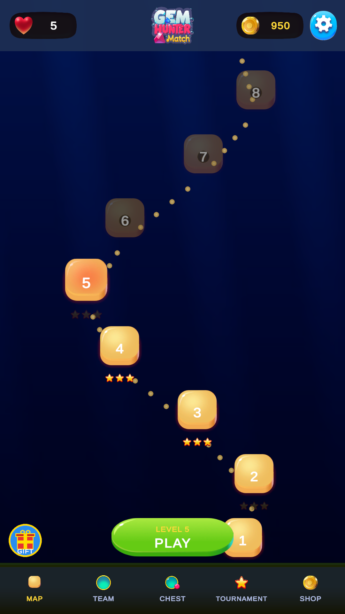
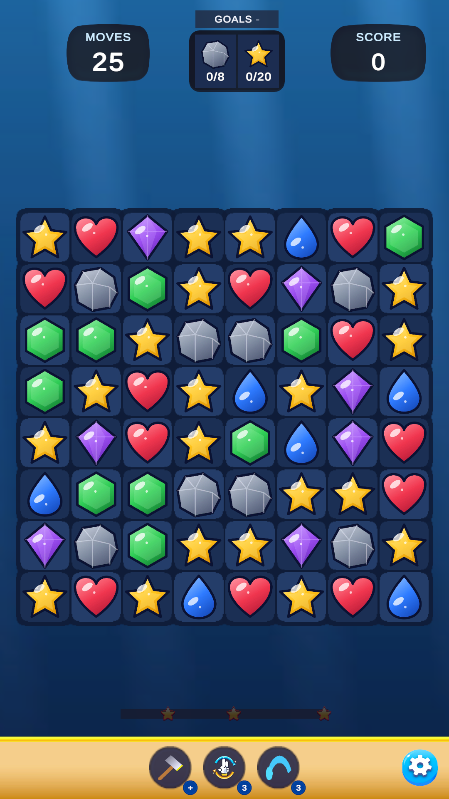

# Match-3 Oyunu

[English](README.md) | **Türkçe**

<p align="center">
  
  
</p>

<p align="center">Tam oynanış videosu (50 MB, yaklaşık 3 dakika): <a href="Screenshots/gameplay.mp4">Screenshots/gameplay.mp4</a></p>

Unity 6 ile geliştirilmiş, Android için dikey ekran, 2D bir Match-3 mobil
oyunu. Proje aynı zamanda temiz ve bellek ayırmayan (allocation-free) bir oyun
mimarisi çalışmasıdır: tek bir kompozisyon kökü, açık bir state machine,
sistemler arası sinyal tabanlı iletişim ve kritik yolda üçüncü parti tween
kütüphanesi yerine elle yazılmış bir tween sistemi.

- Motor: Unity 6 (yazım anında `6000.6.0f1`, Unity 6 hattını hedefler)
- Render pipeline: Universal Render Pipeline (2D, unlit)
- Girdi: Unity Input System (yeni)
- Hedef platform: Android (min SDK 26). Assembly'lere Editor ve WebGL de dahildir.
- Yönelim: dikey, kilitli
- Kare hızı: 60 FPS hedefi

---

## İçindekiler

1. [Özellikler](#özellikler)
2. [Başlangıç](#başlangıç)
3. [Oynanış özeti](#oynanış-özeti)
4. [Mimari](#mimari)
5. [Proje yapısı](#proje-yapısı)
6. [Sistemler ayrıntılı](#sistemler-ayrıntılı)
7. [Performans kuralları](#performans-kuralları)
8. [İçerik hazırlama](#içerik-hazırlama)
9. [Kalıcılık ve meta sistemler](#kalıcılık-ve-meta-sistemler)
10. [Hata raporlama ve gizlilik](#hata-raporlama-ve-gizlilik)
11. [Test](#test)
12. [Yol haritası](#yol-haritası)
13. [Kodlama kuralları](#kodlama-kuralları)
14. [Lisans ve katkılar](#lisans-ve-katkılar)

---

## Özellikler

### Temel oynanış
- Kaydırarak yer değiştirme (swap) tabanlı Match-3. Zincirleme eşleşmeler (cascade),
  yeniden doldurma ve hamle kalmadığında otomatik karıştırma.
- Düzensiz tahta şekilleri: hücreler oynanamaz olarak işaretlenebilir.
- Seviye başına ayarlanabilir tahta boyutu ve aktif taş rengi sayısı.
- Çapraz yerçekimi: taşlar engellerin etrafından deterministik biçimde kayabilir.
- Girdi tamponu: tahta durulmadan hemen önce yapılan kaydırma hatırlanır ve tahta
  boşa çıktığı anda uygulanır.
- Ayarlanabilir bekleme süresinden sonra olası bir hamleyi gösteren ipucu sistemi.

### Özel taşlar
| Eşleşme | Sonuç |
|---|---|
| Yan yana 4 | Roket (yatay veya dikey) |
| L veya T şekli | Bomba |
| Düz 5 | Renk Bombası |
| 2x2 kare | Pervane (hedefe uçar) |

Yan yana iki özel taş birleştirilerek kombo etkisi elde edilir (örneğin Roket +
Bomba, Renk Bombası + Roket). Renk Bombası bir özel taşla birleştiğinde
tahtadaki en çok bulunan rengi o özel taşa çevirir.

### Engeller
- Kutu, Kaya ve Buz. Çok aşamalı hasar görselleri ve vurulunca sarsılma animasyonu vardır.
- Engeller komşu hücredeki eşleşmeyle hasar alır, düşmez, eşleşmez ve yer
  değiştirilemez.
- Yerleştirme: elle koordinat listesi, rastgele (Fisher-Yates) veya CSV dosyası.

### Hedefler ve seviyeler
- Hedef türleri: taş topla veya temizle, özel taş oluştur, malzemeyi (ingredient) en alt satıra indir.
- Hamle sınırlı veya süre sınırlı seviyeler.
- Skor ve yıldız derecelendirmesi.
- Kazanma finali: kalan hamleler özel taşa dönüşüp patlar.
- Hamle bitince "+5 hamle ile devam et" akışı.
- Az hamle uyarısı (son 5 hamlede kırmızı vignette).

### Oyun içi güçlendiriciler
- Çekiç (tek hücre kırar), Eldiven (iki taşı yer değiştirir) ve Karıştır; alt
  çubuktan, hamle harcamadan kullanılır.
- Seviye başında kullanılan güçlendiriciler yalnızca seviye sıfırdan başlarken düşülür.

### Meta oyun
- Royal Match tarzı ana menü ve seviye önizleme ile başlatma akışı olan kavisli
  saga haritası.
- Zamanla yenilenen canlar, altın, ayarlar (ses, müzik, titreşim).
- Kaydet ve devam et: tahta, hamle veya süre, skor ve hedefler uygulama
  kapanıp açılınca korunur.

### Hissiyat (juice)
- Fiziksel hissiyatlı easing: hızlanan düşüş, inişte sekme, yumuşak frenlemeli swap.
- Eşleşmede partikül efektleri, elektrik ışınları, roket izleri, dalga gecikmeli patlamalar.
- Prosedürel ses efektleri, zincirlemede yükselen perde (pitch) ve mobil titreşim.

---

## Başlangıç

### Gereksinimler
- Unity 6 (proje en son `6000.6.0f1` ile açıldı; bkz.
  `ProjectSettings/ProjectVersion.txt`).
- Cihaz buildi için Android Build Support modülü.
- Çökme raporu istiyorsan bir Firebase projesi (aşağıya bak). Oyun onsuz da çalışır.

### Projeyi açma
1. Repoyu klonla.
2. Klasörü Unity Hub ile yukarıdaki Unity sürümüyle aç. Paketler ilk açılışta
   `Packages/manifest.json` dosyasından geri yüklenir.
3. `Assets/Scenes/SampleScene.unity` sahnesini aç ve Play'e bas.

Proje, domain reload kapalı Enter Play Mode ayarıyla çalışır; bu yüzden her
sinyal sınıfı `SubsystemRegistration` anında abonelerini temizler.

### İsteğe bağlı paketler
`Packages/manifest.json` içinde yalnızca editörde kullanılan bazı paketler
bulunur (örneğin Unity AI assistant). Oyunu çalıştırmak veya build almak için
gerekmezler, manifest'ten çıkarılabilirler.

### Firebase (isteğe bağlı, yalnızca Android)
Repo Firebase yapılandırması içermez. Crashlytics `ErrorHandling` modülü
üzerinden bağlanmıştır ve yalnızca Android cihaz buildlerinde derlenir
(`UNITY_ANDROID && !UNITY_EDITOR`).

Etkinleştirmek için:
1. Bir Firebase projesi oluştur ve kendi paket adınla bir Android uygulaması ekle
   (paket adı Player Settings'te, şu an `com.karayilann.match3game`).
2. `google-services.json` dosyasını indirip `Assets/DataTracking/google-services.json`
   yoluna koy.
3. Firebase Unity importer'ın Android kaynaklarını üretmesine izin ver.
4. Google Cloud Console'da API anahtarını paket adına ve SHA-1 imza sertifikasına
   göre kısıtla.

Bu yollar bilerek git tarafından yok sayılır, böylece yapılandırman asla
commitlenmez. Editörde proje `NullErrorReporter` kullanır ve bunların hiçbirine
ihtiyaç duymaz.

### Build alma
`File > Build Settings > Android` kullan. Yayın buildi için kendi keystore'unu
oluştur. Keystore ve şifrelerini asla commitleme.

---

## Oynanış özeti

Oyuncu iki komşu taşı yer değiştirir. Hamle üç veya daha fazla taşlık bir eşleşme
oluşturursa eşleşen taşlar temizlenir, üstteki taşlar düşer, yukarıdan yeni taşlar
dolar ve yeni eşleşme oldukça döngü devam eder. Hamle eşleşme oluşturmazsa animasyonla
geri alınır. Tüm hedefler tamamlanınca seviye kazanılır, hamle veya süre bitince
kaybedilir (devam etme seçeneğiyle).

Bir turun akışı:

```
Idle -> Swap -> (Match -> Fall -> Fill -> Match ...) -> Idle | Reshuffle
```

---

## Mimari

### İlkeler
- Tek yönlü, döngüsüz assembly bağımlılıklarıyla Clean Architecture.
- Tek kompozisyon kökü (`BoardController`), her şey elle constructor injection ile
  bağlanır. DI container yoktur.
- Sistemler birbiriyle dört statik sinyal sınıfı üzerinden konuşur. Tahta
  döngüsünün içindeki adımlar state machine üzerinden doğrudan çağrılır.
- Kritik yollarda sıfır bellek ayırma, işe yaradığı yerde bayt düzeyinde veri düzeni.
- YAGNI ve KISS: soyutlamalar ihtiyaç doğunca eklenir, önceden değil.

### Assembly'ler

| Assembly | Referanslar |
|---|---|
| `Core`, `Utils`, `Ads`, `ErrorHandling` | yok |
| `Signals` | `Core` |
| `View` | `Core`, `Signals`, TextMeshPro, PrimeTween |
| `Gameplay` | `Core`, `Signals`, `View`, `Utils`, `ErrorHandling`, Input System, uGUI |

Tüm assembly tanımlarında yalnızca Editor, Android ve WebGL platformları dahildir
("Any Platform" kapalı, "Include" modu).

### Sinyaller
Sistemler arası iletişim `Signals` assembly'sindeki dört sınıf üzerinden yürür:
`BoardSignals`, `LevelSignals`, `EconomySignals` ve `UiSignals`.
- Her sinyal bir `public static event`'tir; tetikleme `RaiseX(...)` ile yapılır, bu
  yüzden dışarıdan `=` ataması veya doğrudan `Invoke` yapılamaz.
- Her sınıf `SubsystemRegistration` anında `Reset()` ile abonelerini temizler; bu,
  domain reload kapalıyken projeyi güvenli tutar.
- Yeni sinyal eklerken event, `Raise` metodu ve `Reset` satırı birlikte eklenir.

### State machine
`GameStateMachine` ve state'ler `Gameplay/States` altındadır:

| State | Sorumluluk |
|---|---|
| `IdleState` | Girdiyi açar, ipucu zamanlayıcısını çalıştırır. |
| `SwapState` | Girdiyi kapatır, swap'i animasyonla oynatır, doğrular, eşleşme yoksa geri alır. Kilitli hücreye dokunan swap'i reddeder. |
| `MatchState` | Eşleşmeleri bulur, komşu engellere hasar verir, özel taş üretir, temizleme batch'ini oynatır, sonra Idle veya Reshuffle'a karar verir. |
| `FallState` | Sütun bazlı çok geçişli yerçekimi, çapraz kayma dahil. Kilitli hücreler yazma noktasını durdurur. |
| `FillState` | Yeni taşları grid'in bir satır üstünden düşürür, düşme mesafesi boşluk büyüklüğüne bağlıdır. |
| `ReshuffleState` | Kilitsiz hücreleri Fisher-Yates ile karıştırır, eşleşme olmayıp en az bir hamle olana kadar en fazla 20 deneme. |

State'ler iş bitince doğrudan `ChangeState` çağırmaz. Tamamlanma callback'li bir
`BoardAnimator` batch'i başlatırlar; böylece cascade zinciri tek karede iç içe
çalışmaz ve her adım görünür kalır. State'ler küçük paketlere (`BoardData`,
`BoardPresentation`, `LevelServices`) bağlıdır, her biri yalnızca ihtiyacı olanı
alır. State'ler birbirine referans verdiği için önce oluşturulur, sonra
`BoardStates.Init(...)` ile bir kez bağlanır.

### Animasyon
- `BoardAnimator` ince bir MonoBehaviour'dır, tüm animasyonları tek `Update` sürer.
  Tek tek taşların `Update`'i yoktur.
- `TweenRunner` önceden boyutlandırılmış komut listesi, easing ve O(1)
  swap-with-last silme kullanır.
- `ElectricBeamRenderer` ve `RocketTrailRenderer` `LineRenderer` havuzlar.
- `SpecialTileChoreographer` özel taş efektlerini (dalga gecikmeleri, mermiler,
  ışınlar, partiküller) aynı batch'e sıralar.
- UI animasyonları `View` assembly'sinde PrimeTween ile yapılır. Tahta animasyonu
  elle yazılmış tween sistemini kullanır.

### Render ve girdi
- Tahta World Space `SpriteRenderer`'lardan oluşur. Grid için Canvas kullanılmaz
  (UI rebuild maliyetinden kaçınmak için), Canvas yalnızca HUD'dadır.
- Collider ve Physics2D yoktur. Dokunuş matematikle grid koordinatına çevrilir
  (`GridToWorldConverter`, önbelleğe alınmış ters hücre boyutuyla).
- `BoardInputHandler` yeni Input System'i olay tabanlı kullanır (`Update` yok),
  tap ile swipe'ı piksel eşiğiyle ayırır ve byte underflow'a karşı korur.
- `CameraFitter` ortografik boyutu tahtaya ve HUD alanlarına göre sığdırır.

---

## Proje yapısı

```
Assets/
  Scripts/
    Core/             veri tipleri, state machine tabanı, pooling, singleton
      Data/           Tiles, Level, Goals, Obstacles
      StateMachine/   IGameState, GameStateMachine
      Pooling/        IPoolableObject, PoolManager<T>
      Singleton/      MonoSingleton<T>
    Gameplay/
      Board/          BoardModel, BoardController (kompozisyon kökü), dönüştürücüler, kamera
      Matching/       MatchDetector, PossibleMoveDetector
      States/         Idle, Swap, Match, Fall, Fill, Reshuffle
      Input/          BoardInputHandler
      Spawning/       TileSpawner
      Animation/      BoardAnimator, TweenRunner, ışınlar, izler, koreografi
      Obstacles/      ObstacleService, ObstaclePlacer
      Boosters/       oyun içi ve seviye öncesi güçlendiriciler
      Hints/          HintService
      Ingredients/    malzeme hedefi mantığı
      Scoring/        ScoreService
      Goals/          GoalLoader, GoalService
      Flow/           AppBootstrap, MenuFlowController, WinFinaleController
      Persistence/    key-value deposu, kaydet ve yükle
      Economy/        PlayerInventory, EconomyRequestHandler
      Lives/          LivesService, LivesController
      Progress/       ProgressService
      Settings/       SettingsService
      Clock/          ITimeProvider, SystemTimeProvider
      Audio/          prosedürel ses ve titreşim
    Signals/          BoardSignals, LevelSignals, EconomySignals, UiSignals
    View/             GemView, partiküller, HUD, görünüm tarafı animasyon
    ErrorHandling/    IErrorReporter, ErrorReporter, Firebase sağlayıcısı
    Ads/              reklam soyutlaması için ayrıldı
    Utils/            Debug sarmalayıcısı, CsvSpanReader
  Tests/
    EditMode/         mantık ve servis testleri
    PlayMode/         tahta akışı, kaydet/devam, fuzz testleri
  ScriptableObjects/  seviyeler, engel ve taş veritabanları
  Scenes/             SampleScene
  Audio, Sprites, Prefabs, Materials, Resources, StreamingAssets
```

Klasörler "bu tip ne?" sorusuna göre ayrılır, "kim kullanıyor?" sorusuna göre
değil. `Utils` klasörü yalnızca saf, durumsuz yardımcıları içerir. Arayüzler
merkezi bir klasörde değil, kendi feature klasöründe implementasyonuyla durur.

---

## Sistemler ayrıntılı

### Veri katmanı (`Core/Data`)
- `GridCoord`: `readonly struct`, iki `byte`.
- `TileType` (byte enum): `None, Red, Blue, Green, Yellow, Purple, White, Box`.
  `Box` bir renk değil, "bu hücre engel taşıyor" işaretçisidir.
- `CellFlags` (byte flags): `None, NonPlayable, Locked, ...`.
- `GridCell`: tip, bayraklar ve dayanıklılık, `Pack = 1` ile paketlenmiş.
- `TileTypeLibrary.PLAYABLE_TYPES` spawn havuzunun tek kaynağıdır. Renk eklemek
  için: enum'a ekle, bu diziye ekle, `TileSpriteDatabase`'e doğru indekste sprite
  koy. Başka kod değişmez.
- `TileSpriteDatabase` sprite'ları enum sırasıyla doldurulmalıdır.

### Eşleşme
- `MatchDetector`: satır ve sütun bazlı run-length tarama. Flood fill ve recursion
  yok. Minimum eşleşme 3. Oynanamaz, kilitli ve boş hücreler yok sayılır.
  Eşleşme bayrak dizisi bir kez ayrılır.
- `PossibleMoveDetector`: her hücrenin sağ ve alt komşusuyla varsayımsal swap dener,
  `MatchDetector` ile kontrol eder, geri alır ve ilk bulguda durur. Tahta
  durulduğunda bir kez çalışır. İpucu sistemi için koordinat da döndürebilir.
- `TileSpawner` başlangıç tahtasını hazır eşleşme olmadan doldurur. `MatchDetector`
  tüm tahtayı taradığı için aksi halde her swap geçerli sayılırdı.

### Engeller
Engel hücresinde `CellFlags.Locked` bayrağı vardır. `ObstaclePlacer` bunu koyar,
`ObstacleService` dayanıklılık sıfırlanınca temizler. Bir engel tek resolve
geçişinde en fazla bir hasar alır. `ObstacleDefinition` davranış alanlarını
(`CanTakeAdjacentDamage`, `SpawnsTileOnDestroy`, `CanFall`) taşır, böylece yeni
engel türleri veriyle tanımlanabilir.

### Hedefler ve skor
`GoalLoader` hedefleri seviye verisinden (Inspector dizisi veya CSV) kurar.
`GoalService` ilerlemeyi izler ve sinyal gönderir. `ScoreService` eşleşmeleri
seviyedeki `PointsPerTile` ile puanlar.

### Nesne havuzu
`Core/Pooling` bağımsız bir modüldür: `IPoolableObject` (`OnSpawn`, `OnDespawn`) ve
`PoolManager<T>` (kuyruk tabanlı, prewarm destekli). Olduğu gibi başka projeye
kopyalanabilir.

### HUD
HUD, `Scale With Screen Size` canvas kullanır (referans 1080x1920, match 0.5),
`SafeAreaFitter` ile `Screen.safeArea` uygular ve TextMeshPro kullanır. Popup'lar
`PopupCanvas` altında ortak bir `PopupView` tabanını paylaşır.

---

## Performans kuralları

- Kritik yollarda bellek ayırma yok: `new List<>()` yok, LINQ yok, `List` üzerinde
  `foreach` yok, string üretimi yok. Buffer'lar constructor'da bir kez ayrılır ve
  `Clear()` ile yeniden kullanılır.
- Sabit bölen, önbelleğe alınmış tersine çevrilip çarpma olarak kullanılır.
- Ömür boyu sabit değerler (width, height) metot parametresi değil, `readonly`
  alandır.
- Küçük struct'larda `[StructLayout(LayoutKind.Sequential, Pack = 1)]`, sık
  çağrılan property getter'larında `[MethodImpl(MethodImplOptions.AggressiveInlining)]`
  kullanılır.
- Koordinat, tip ve bayraklar için `byte`. World pozisyonları `float` kalır.
- Tüm animasyon için tek `BoardAnimator.Update`, taş başına `Update` yok.
- `GemView` içinde `Transform` önbelleğe alınır (native-managed geçiş maliyeti).
- İki sprite atlası (`Assets/Sprites/Atlases`), mipmap kapalı, MSAA kapalı,
  post-processing, gerçek zamanlı ışık ve gölge yok.

### İddiaları doğrulama

`Assets/Tests/EditMode/HotPathPerformanceTests.cs` yukarıdaki kuralları, bozulunca
başarısız olan testlere çevirir:

- `MatchDetector` ve `PossibleMoveDetector`, ısınmadan sonra 8x8 tahtada 2000
  taramada tam olarak 0 bayt ayırmalıdır (`GC.GetAllocatedBytesForCurrentThread`
  ile ölçülür).
- İkisi de tarama başına gevşek bir süre bütçesinin içinde kalmalıdır; bu,
  yanlışlıkla gelen O(n^2) gerilemeleri yakalar. Tarama başına ölçülen mikrosaniye
  test çıktısına yazılır. Editör (Mono) süreleri IL2CPP cihaz buildinden yavaştır.

Ölçülen sonuçlar (Unity 6000.6.0f1, Mono üzerinde Editör, 8x8 tahta, 2000 tarama,
tek bir geliştirme bilgisayarı; mikrosaniyeleri kabaca bir gösterge say):

| Kontrol | Sonuç | Sınır |
|---|---|---|
| `MatchDetector` bellek ayırma | 0 bayt | 0 bayt |
| `PossibleMoveDetector` bellek ayırma | 0 bayt | 0 bayt |
| `MatchDetector` tam tahta taraması | 6,63 us | 200 us |
| `PossibleMoveDetector` taraması | 5,88 us | 2000 us |

Gerçek cihazda kare süresi, bellek ve draw call için Unity Profiler'ı bir Android
development build'e bağlayarak kullan.

---

## İçerik hazırlama

### Seviye oluşturma
1. `Create > Match3 > Level Data`.
2. Kimliği (`LevelId`, `LevelOrder`), tahta boyutunu, aktif renk sayısını, limit
   türünü (hamle veya süre) ve değerini, taş başına puanı ve ipucu ayarlarını doldur.
3. Hedefleri Inspector dizisi veya CSV dosyasıyla ekle.
4. Engelleri elle, rastgele veya CSV'den (`X,Y,Type` satırları) ekle.
5. İstersen düzensiz tahta şekli için hücreleri oynanamaz olarak işaretle (Inspector veya CSV).

CSV dosyaları `Utils.CsvSpanReader` ile okunur; bu, bellek ayırmayan
`ReadOnlySpan<char>` tabanlı bir okuyucudur.

### Sahne kontrol listesi
1. `TileSpriteDatabase` sprite'ları enum sırasındadır.
2. `ObstacleDatabase` her engel için ilişkili taş tipi, sprite ve dayanıklılık içerir.
3. Engel koordinatları grid sınırları içindedir (0..width-1, 0..height-1).
4. `BoardController`, `CameraFitter`, `BoardInputHandler` ve `BoardAnimator`
   sahnededir ve referansları atanmıştır.
5. Player Settings > Active Input Handling `Input System Package (New)` veya `Both`.
6. Kamera ortografiktir, MSAA kapalıdır, sprite'lar atlas ve materyal paylaşır.

---

## Kalıcılık ve meta sistemler

- Oyun kodu `PlayerPrefs`'e doğrudan dokunmaz. Her şey `IKeyValueStore` üzerinden
  gider (`PlayerPrefsKeyValueStore`, testlerde `InMemoryKeyValueStore`). Tek istisna
  `SaveLoadService` içindeki seviye içi binary kayıttır.
- Her verinin tek sahibi vardır: `PlayerInventory` (altın, güçlendiriciler),
  `LivesController` (can yenilenmesi, `ITimeProvider` ile), `ProgressService`
  (açılan seviye, en iyi yıldızlar), `SettingsService` (ses, müzik, titreşim).
- View'lar ekonomi, ilerleme veya ayar verisi yazmaz. İstek sinyali gönderirler,
  `EconomyRequestHandler` işler, değerleri sinyallerden okurlar.
- `MenuFlowController` servisleri kurar, durumlarını `Start`'ta ve ekran
  değişimlerinde yayınlar.
- Seviye öncesi güçlendiriciler yalnızca seviye sıfırdan başlarken düşülür.

---

## Hata raporlama ve gizlilik

- `ErrorHandling` bağımlılıksızdır. Oyun kodu yalnızca `ErrorReporter` çağırır,
  arka ucu bilmez. Varsayılan `NullErrorReporter`'dır.
- `UnhandledExceptionHook` yakalanmayan istisnaları oturum başına en fazla 50 kez
  raporlar.
- Firebase Crashlytics sağlayıcısı yalnızca Android'dedir ve kendini
  `[RuntimeInitializeOnLoadMethod]` ile kaydeder. Hazır olmadan gelen çağrılar
  düşürülür.
- Crashlytics cihaz modeli, işletim sistemi sürümü, bellek, disk, pil, ekran yönelimi
  ve uygulama sürümünü kendisi toplar.
- `SetUserId` üzerinden kişisel veri (ad, e-posta) gönderme.
- Bir build yayınlarsan, çökme ve tanılama verisi toplandığını mağazanın veri
  güvenliği formunda ve gizlilik politikanda belirt.

---

## Test

Testler Unity Test Framework kullanır.

- EditMode: eşleşme ve hamle tespiti, engeller, hedefler, özel taşlar, canlar,
  envanter, ilerleme ve ayar servisleri.
- PlayMode: tam tahta akışı, kaydet ve devam, bir seviyede fuzz testi.

`Window > General > Test Runner` üzerinden veya komut satırından çalıştır:

```powershell
Unity.exe -batchmode -projectPath . -runTests -testPlatform EditMode -testResults results.xml
```

PlayMode `BoardProbe`, bazı `BoardController` alanlarını reflection ile okur
(`_boardModel`, `_stateMachine`, `_views`, `_limitService`, `_idleState`,
`_reshuffleState`, `_matchState`, `_goalService`, `_spriteDatabase`). Bu isimleri
koru veya yeniden adlandırırken probe'u güncelle.

---

## Yol haritası

Planlanan işler, kabaca sırayla:

1. Sağlamlaştırma: cihaz profili ve çentik testleri, cihazda manuel test listesi.
2. Daha fazla engel: zincir, çim veya halı, kilit ve anahtar, yayılan engeller,
   portal, konveyör.
3. Zorluk eğrisi, daha fazla seviye, öğretici (FTUE).
4. Ekonomi: seviyeden çıkınca can kaybı, günlük ödüller, sandıklar, satın alma
   doğrulamalı mağaza.
5. Altyapı: analitik, uzaktan config, seviye editör aracı, çoklu dil, erişilebilirlik.
6. Hile önleme notları: imzalı kayıt verisi, saat değişikliğine dayanıklı tek zaman
   kaynağı, sunucu tarafı satın alma doğrulaması.
7. Reklamlar `IAdsProvider` soyutlamasının arkasında, null implementasyonla; SDK
   eklenince oyun mantığı değişmez.

---

## Kodlama kuralları

- Yorumlar İngilizce. Satır içi `//` yorum yok. `/// <summary>` yalnızca karmaşık
  metotlarda ve NE değil NEDEN'i anlatır.
- Sınıflar `PascalCase`, private alanlar `_camelCase`, event'ler `On` ile başlar,
  sabitler `UPPER_SNAKE_CASE`. Inspector alanları `[SerializeField] private`.
- Enum'lar `byte` tabanlı. Namespace'ler klasör hiyerarşisini yansıtır.
- `UnityEngine.Debug` kullanılmaz. `Utils.Debug` kullanılır
  (`[Conditional("UNITY_EDITOR")]` ile yalnızca editörde).
- UI metinlerinde, kodda ve asset'lerde emoji veya özel sembol yok. TextMeshPro
  fontu (`LiberationSans SDF`) bunları gösteremez, kutucuk çıkar. İkon için sprite kullan.
- UI metinleri İngilizce.

---

## Lisans ve katkılar

- Özgün kod ve proje verisi: MIT, bkz. [`LICENSE`](LICENSE).
- Üçüncü taraf sanat, ses, paket ve SDK'lar kendi koşullarına tabidir, bkz.
  [`THIRD_PARTY_NOTICES.md`](THIRD_PARTY_NOTICES.md).
- `Assets/GemHunterMatch` altındaki sanat MIT lisansı kapsamında değildir.
  Yeniden dağıtmadan veya kullanmadan önce özgün lisansını kontrol et.
